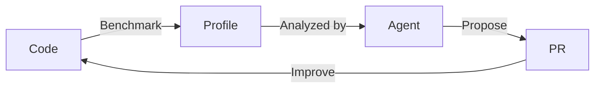

<figure class="float-figure float-right">
  }}assets/2026-10-14-agentic-dev-and-rust/sheldon.gif" alt="Sheldon breathing into a paper bag.">
  <figcaption>Me, calmly assessing the implications of LLMs for programming language design(ers).</figcaption>
</figure>

As someone who has made a career of programming language design, I definitely have moments of existential dread about the rise of LLMs. I started coding in 5th grade on an x86[^secret] that ran at 5MHz, had something like a 5MB hard-disk and 512K of RAM[^dad]. Computers were really, really different back then. But honestly, programming wasn't. For all the advances in IDEs and programming languages and so forth, the basic act of entering code into a file has remained surprisingly constant[^vim] -- right up until a few years ago, when everything kinda turned on its head. That's been exciting and empowering at times[^electron] but also scary and disorienting. *Will my skills in programming matter? What about my skills in programming language **design** (such as they are)?* This blog post is my attempt to answer those questions.

[^vim]: I mean my god, we're even using `vi` again! My first editor!

So as not to keep you in suspense, let me just give you the conclusion. In short, **yes, I believe there will still be a role for humans in programming**. And **yes, I think that programming language design is still relevant**. And, naturally, I also happen to think Rust is a **really good fit** for agentic development -- but that's not to say we can't make it a **better fit**. And that's what this post is ultimately about: what makes Rust and agentic development work well, and where we could double down on those strengths.

[^secret]: Secretly I have always been jealous of people that coded using punchcards and stored things on gigantic rolls of tape or whatever. I just want to be world weary so badly! I am kinda delighted that I'm finally old enough that I can say things like "I remember when we had to edit CONFIG.SYS before we could play a computer game!" and younger programmers will gasp in horror.[^alexcrichton] But I still feel like I must sound like a silly kid to folks who were around "back in the day".

[^alexcrichton]: I remember once trying to tell Alex Crichton how I used to "order shareware from a paper catalog by putting a check in the mail" and he was like "I do not understand any of the nouns in that sentence". Highlight of my life, right after Rust 1.0. Oh, and maybe the birth of my child and getting married. I guess.

[^electron]: I built an electron app! And it was so easy to do! And reading weird papers and things is so much more accessible now that I can ask an LLM to translate all the math jargon for me.

[^dad]: I still remember when my dad told me he had bought me a 10MB disk and *secretly* he had bought a **40MB** disk to surprise me. It seemed absurdly large. "I'll never need a new disk again!"

> *This is a kind of "blog post companion version" of a [talk I gave this week at REBASE, part of SPLASH](https://1drv.ms/p/c/fc6238e2c825ad8e/IQAicCGAOWyUSoas_zx8h6FwAX4K-qU23eeypjxQwXlNBF4?e=BkH84j). You might also enjoy the slides from the talk I gave at IWACO, [IWACO and Rust: hidden links revealed](https://1drv.ms/p/c/fc6238e2c825ad8e/IQAyyfEu4SdnSaW2Qnlc82wCATs6-S3dGrni0DB3NjpNrkQ?e=rOLmkW), which was a bit more of a retrospective (no soundtrack for those, though). In any case, this turned out to be a great conference! [Jack Huey presented on the Rust Vision Doc](https://conf.researchr.org/profile/splash-issta-2026/jackhuey) and, quite to my surprise, Steve Klabnik and Dorian Scheidt presented ["LLMs as Collaborators in Language Specification and Design"](https://conf.researchr.org/details/splash-issta-2026/plss-2026/7/LLMs-as-Collaborators-in-Language-Specification-and-Design), talking about their process in building out [Rue](https://steveklabnik.com/writing/thirteen-years-of-rust-and-the-birth-of-rue/). It was fun to see Steve again. On top of that, there was a ton of great research presented at IWACO in particular. I was particularly taken by the work on [Reachability Types](https://dl.acm.org/doi/10.1145/3485516) and [Information Borrowing](https://conf.researchr.org/home/splash-issta-2026/iwaco-2026#program). I also really liked learning about [Hylo Lang](https://hylo-lang.org/), particularly their approach to projections. Clever and cool.*

<!--more-->

## Rust is popular in the agentic era

<figure class="float-figure float-right">
  }}assets/2026-10-14-agentic-dev-and-rust/be-honest.png" alt="Meme dialogue: “I wrote this in Rust!” “Be honest.” “I am being honest!” “An agent wrote it.” “Thank you.”">
  <figcaption>From the most important Slack channel at Amazon, #aws-memes.</figcaption>
</figure>

Rust is popular right now. [Very popular:](https://x-thread.org/t/2087229652293337160)

> Stratospheric among the breakout languages is TypeScript, cropped from the chart and sitting currently at +1200% growth from the prior year. \[..\]
>
> The second most rapid recent growth is in Rust. **Meta engineers have written twice as much first-party Rust code so far this year than in the previous 9 years combined.**
>
> &mdash;  David Tolnay (emphasis mine)


Some of that is because agents make it very easy to try out new things. And some of that is because Rust has a reputation for being performant and, if it's just as easy to pick any language, why not pick one that will yield faster execution times?

**But I think Rust is popular for another reason: because Rust happens to be a really good fit for agentic coding**[^only]. Of course, I would, wouldn't I? The point of this post is (1) to argue for why that is and then (2) to discuss what we might change about Rust to make it work even better.

[^only]: I'm not saying Rust is the *only* language that's a good fit. I'm not even saying that the way that Rust is a good fit is the only way to be a good fit. I have heard for example that Go is a really good fit for agentic coding and I believe it: I think it hits a different sweet spot, one that helps agents iterate quickly (although I do suspect agents will let data races and subtle bugs slip through that Rust would have prevented).

## Foundational Software construction with agents

It seems to me that an effective "software factory" will have three pillars:

* *Design:* figure out and specify clearly what the code is supposed to do.
* *Construction:* author code that does what it is supposed to do.
* *Optimization:* optimize the code so that it runs efficiently.

None of these pillars are solved, but some have made more progress than others.

## Rust and optimization: fast by default, knobs when you need 'em

Rust is designed to give "good performance by default", making the idiomatic thing typically also be the fastest thing. But another key part of Rust is that you have the knobs to eke out better performance when you need it. You control when something is stack- or heap-allocated and where pointer indirection occurs. If you want to, you can force the layout of your structs to be done in a particular way, or decide where to introduce boxing into your async stack frames. In the limit, you can put in inline assembly.

In the past, learning how to "tune the performance knobs" could be a bit of a black art: but agents are making that much easier.[^gc] It turns out that agents are *really good* at fine-tuning the performance of existing code. For example, people who work on super high-performance cryptographic algorithms used to do so by hand-tuning assembly code. But those people tell me that they are now turning to agents for that same job. More prosaicly, a lot of people building network services are finding that, using a profiler like [dial9](https://github.com/dial9-rs/dial9), agents can quite effectively diagnose async performance pitfalls, like long polls or blocking.

[^gc]: The fact that agentic development makes more room for knobs is good for Rust performance, but it is quite likely an even better fit for performance in other languages. Tuning a GC has traditionally been a job that really requires a GC expert, but agents can likely fill that role pretty well these days.

Therefore, I think the task for Rust is clear. We keep on with our goal of ["low-level enough for a kernel, high level enough for a GUI"](https://smallcultfollowing.com/babysteps/blog/2025/10/13/ergonomic-explicit-handles/). If anything, I think the shift around agents means we can tolerate a bit more "noise" in the form of explicit calls to `clone()` or `share()` -- but not too much, since we still want the "happy path" of the code to be clear and evident[^ergrc], even as we surface details that are important in specific scenarios (like tracking precisely how many clones you have of a channel endpoint). Combined with a profiler, you get an effective feedback loop to get your code running fast:

[^ergrc]: On this pont, I'm even more convinced of the importance of ergonomic RC now that I work with agents. Agents are good at introducing the extra clones and things you need to deal with capturing around async tasks, but the resulting code is so annoying to read, it really hides what's going on.



## Reliability is king, as always

As usual though, while a reputation for good performance is what brings people to Rust, what makes them want to *stay* is a sense that using Rust "just seems to work better". The basic theory is that Rust's type system and guardrails [help keep agents on track](https://x.com/gdb/status/2007228511363444905):

<center>
<blockquote class="twitter-tweet"><p lang="en" dir="ltr">rust is a perfect language for agents, given that if it compiles it's ~correct</p>&mdash; Greg Brockman (@gdb) <a href="https://x.com/gdb/status/2007228511363444905?ref_src=twsrc%5Etfw">January 2, 2026</a></blockquote>
<script async src="https://platform.x.com/widgets.js" charset="utf-8"></script>
</center>

I think there's truth in that: languages like Rust, Ocaml, or Haskell all share this "if it compiles, it works" feeling, and I think that agents will benefit from that.

## Testing is not enough, type systems help

> *Testing can show the presence of bugs, but not their absence.*
>
> &mdash; Edsger W. Dijkstra, 1970

<figure class="float-figure float-right">
  }}assets/2026-10-14-agentic-dev-and-rust/nailed-it.gif" alt="A woman presents a lopsided cake with the words “Nailed it!”">
  <figcaption>Agents presenting their work.</figcaption>
</figure>

Writing tests has never been enough to show that your program is correct -- but, with agents, it's not even close. It happens so often that my first few tests seem great and then the next one goes completely bonkers. Usually bonkers in a way where I cannot even imagine how that bug could have come about. Then I dig in and I realize the agent completely missed the boat on the logic I was trying to express.[^claude]

[^claude]: "Claude, this is *not* what we talked about!" -- me, all too often.

This is where a type systems really shines -- particularly an advanced one like Rust. Type systems give you some guardrails that keep the agent on track. In Rust, those guardrails extend beyond simple stuff like "do all fields have the correct names" and to stuff like [never having to close a socket](https://blog.skylight.io/rust-means-never-having-to-close-a-socket/).

## Type systems are not enough either

> *Type systems can show the absence of bugs, but not the presence of correctness.*
>
> &mdash; Me, failing to coin a phrase of equal eloquence[^soclose], 2026

[^soclose]: So close though, right? I just .. couldn't land the plane.

So yeah, type systems are helpful! But they have inherent limits. A type system is a simple set of rules that, if you follow them, make sure that you avoid (certain kinds of) mistakes. But they don't tell you that you do the *right* thing -- only that you *don't* do (certain kinds of) *wrong things*. **If you want to go further, you need a proof system** -- something that will let you show that richer properties are actively true, not just that you're avoiding bugs.

As it happens, there are a lot of interesting proof tools for Rust, like [Verus](https://github.com/verus-lang/verus), [Creusot](https://creusot.rs/), [Aeneas](https://aeneasverif.github.io), and [Kani](https://github.com/model-checking/kani). As a starting point, you can prove that your code is panic-free, which will eliminate a lot of bugs, though it is still fundamentally a "type-checker-like" property (i.e., you avoid doing things wrong). But you can also go further and add assertions that show your code is computing the results you expect.

## Strong guardrails give better performance

Deplying proofs is not just good for getting code *right* -- it's good for getting code *fast*. This is somewhat counterintuitive, but it's true. Earlier I mentioned how optimized cryptographic algorithms were now being written by *agents*. Part of what makes that possible is that cryptographic algorithms have a very clear mathematical definition. This means that you can basically tell the agent "do whatever you want, as long as you can prove that the code still computes the correct result". These proofs can be done with theorem provers like [Lean](https://lean-lang.org/) or [Rocq](https://rocq-prover.org/). The blog post ["Why Lean is faster than Rust"](https://kim-em.github.io/blog/2026-7-24-why-lean-is-faster-than-rust/) makes the point quite well.

For Rust, a good example of this would be around unsafe code. Right now, people are sometimes reluctant to deploy unsafe code even if it might make their code faster because it's not worth the risk of getting it wrong. And I applaud that effort. But what if you could use a prover to show that your unsafe code is, in fact, safe (i.e., incapable of causing undefined behavior)? Then you'd be free to optimize to your heart's content.

## If we are going to prove things, do we need type systems?

You might wonder: if we're deploying a proof system on our code, do we still need type systems? I think the answer is definitely yes. Type systems are infinitely simpler to work with, which is why they are much more popular. Using a type system lets you rule out all kinds of annoying bugs so that you can focus your "proof energy" only on the important stuff.

As a simple example of this, consider the following Java code:

```java
void setFoo(Bar bar) {
    this.foo = bar;
    assert this.foo == bar;
}
```

Without seeing more code, it is impossible to prove whether this assertion is true or not! This is because there could be any number of other threads running around mutating `this`. In contrast, the following Rust code *must* be true (at least, so long as the `Eq` operator is reflexive for `Bar`):

```rust
fn set_foo(&mut self, bar: Bar) {
    self.foo = bar;
    assert_eq!(self.foo, bar);
}
```

We know this because the *type system of Rust* guarantees that `&mut self` implies a *unique* reference.

This is in fact exactly how Verus works. By trusting the Rust borrow checker to track uniqueness etc, it simplifies the job of the SMT solver, making proof checking must faster and more reliable than it would be otherwise.

## Where I think Rust should go on reliability

So my take is that Rust should double down on *if it compiles, it works*. As expressive as Rust's type system is, there are plenty of things that it cannot capture. This includes fairly common things, like [this method only reads one particular field](https://smallcultfollowing.com/babysteps/blog/2026/03/21/view-types-max-min/) or [internal references](https://smallcultfollowing.com/babysteps/blog/2024/06/02/the-borrow-checker-within/), but also fancy things like "no logging of personally identifiable information". We should work to lift those limits, giving agents room to prove more complex properties.

We also need to improve the experience of integrating a proof tool by working towards an *extensible compiler*. As cool as the existing Rust-based proof tools are, using them is a janky experience involing annoying macros and pinned compiler versions. We can do better.

## A north star: No more unsafe code

I'd like to propose a north star for Rust: **no more unsafe code**. By that, I don't mean that we never use the `unsafe` *keyword*. Rather, I mean that we have the power to prove that all the unsafe code we write is correct and cannot cause undefined behavior. Don't get me wrong: knowing exactly what code needs to be vetted is a huge step forward, as is normalizing the idea that libraries need to be responsible for protecting their users from undefined behavior via safe API boundaries[^cpp]. But given agents' ability to find vulnerabilities, I think we need to up-our-game if we want to stop the steady stream of CVEs.[^stream]

[^cpp]: All too often, C++ libraries consider it adequate to tell users ["you're holding it wrong"](https://www.wired.com/2010/06/iphone-4-holding-it-wrong/) -- i.e., that they are responsible for causing undefined behavior by misusing the API. Rust takes a clear position that a safe API has to protect its users, no matter how much they abuse it.

[^stream]: To be fair, if Rust is encountering a stream of CVEs, other languages like C++ and Java are encountering a veritable flood, since they lack the protection of Rust's type system.
st takes a clear position that a safe API has to protect its users, no matter how much they abuse it.

## Design is an open problem

But before you go about proving things or optimizing them, you need to have a clear idea of what you are building. As far as I can tell the state of the art here is basically variations on "markdown-driven-development", developing docs and hoping that agents pay attention.

I don't know how much of a role for Rust there is in this space. I think there are some steps we might wind up taking that could be helpful here -- for example, having ways to separate out *interface* from *implementation* so that it's easier to review the interface in isolation or to see when the agent made changes there.[^h] Or perhaps just providing betters tools to review that.

[^UML]: Every time I say this, somebody says, "like UML?" I mean, kind of! In general, I think that agentic programming is breathing new life into a lot of old ideas. 

[^h]: The revenge of `.h` files?

I also think there's space for dedicated "modeling languages", something that let you iterate quickly with agents on the high-level designs and invariants without having to get into the weeds and read the code. I have more thoughts on this but it merits many blog posts all of its own. For the moment, I'll settle for pointing you all at this post by Kari Wilhelm, ["Principles of Anchor Engineering"](https://nappingtoheavymetal.com/post/2026-09-15-principles-of-anchor-engineering/), which I think does a nice job of describing what it means to pull out the key elements of a design and drive the coding from there.

## Conclusion

We covered a lot of ground here, so let me put this all together. What makes Rust a good choice for developing with agents?

* It offers good default perf (why pay more?) and, in conjunction with a profiler, can be tuned as much as you want.
* The type system gives stronger guardrails, and if you setup your agents right, you can strengthen those guardrails through techniques like new types.

And what could make it better, from a language design perspective? Overall, I think it's very similar to what we were doing, except that the way we weight the tradeoffs is tweaked to account for agents doing the code authoring, and humans focused more on code comprehension:

* *If it compiles, it works* -- our type system is our big advantage, we need to make it more expressive and more functional so that agents don't get stuck trying to work around it!
    * And as an adjunct, establish a North Star: Enable *Unsafe code without unsafety* by supporting proof, and see the most widely used Rust libraries proven sound.
* *Low-level enough for a kernel, high-level enough for a GUI* -- make sure we expose the knobs needed to tune for performance, while also making the code's intent clear (but don't worry about golfing the code down to an absolute minimum number of characters).
* *Extensible and versatile* -- one of Rust's great strengths is that, with macros + our type system, we support DSLs and a wide variety of targets. We need to bring that spirit of extensibility into the compiler so we can target more styles of development (e.g., GPU, deep language interop, etc) and also integrate theorem provers and other tools that require more than just tokens.

As a final close, let me point you at this interesting article by Marc Brooker, ["What's easy now? What's hard now?"](https://brooker.co.za/blog/2026/05/18/whats-easy-whats-hard.html). He posits that the more it is possible to clearly specify success criteria for a task, the easier it is, and that we may find that tasks we traditionally think of as 'hard' (e.g., building out an efficient implementation of a cryptographic algorithm) may soon become automated, whereas tasks that we have thoght of as 'easy' (e.g., making a unique, compelling website) may become more valued.

Looking at it from a PL point-of-view, I think Marc's point reinforces my sense that the biggest action is going to come from *design languages*, things that let you capture the *architecture* and *intended behavior* at a very high-level. The goal would be to let humans intuitively specify a design that gets translated into effective guardrails, whether that's type system checks, lints, or theorems to be proven. Agents would then take on the task of translating the design into code written in a traditional PL like Rust, with humans looking at it only rarely. This doesn't make the design of traditional PLs less interesting, but it definitely makes the tradeoffs very different than they were before.